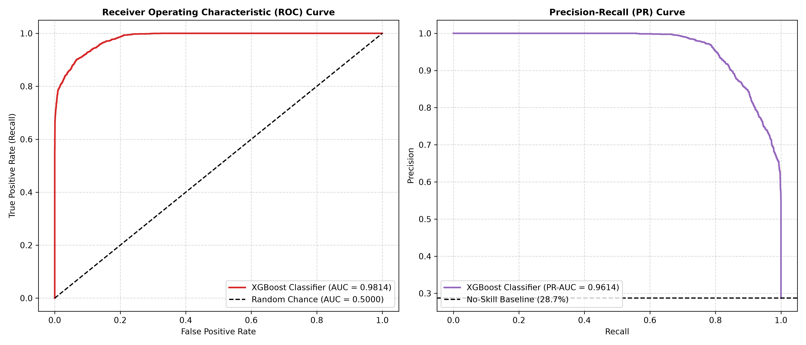
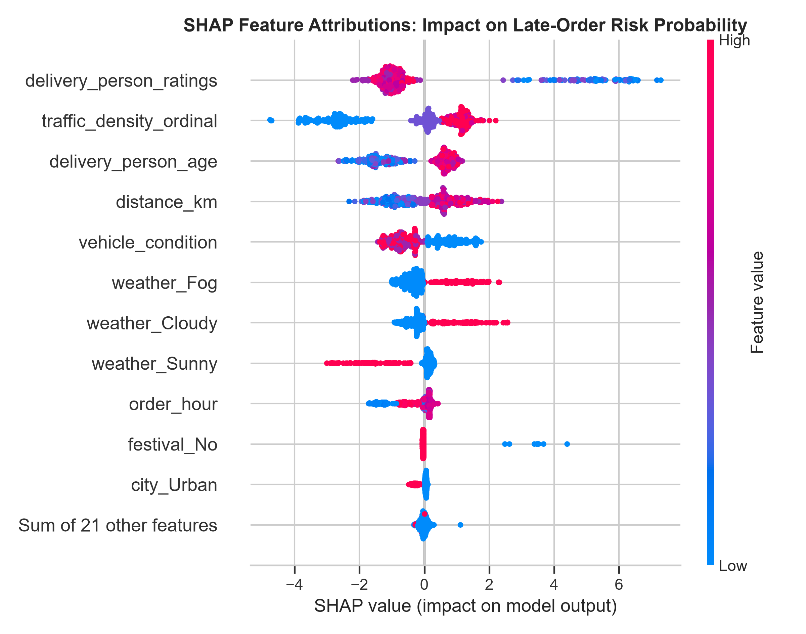

# Late-Order Classification Report: SLA Breach Detection & Risk Modeling

**Project:** Quick-Commerce Delivery Intelligence  
**Task:** Binary Late-Order Classification ($\text{SLA} = 30.0\text{ minutes}$)  
**Target:** `is_late` ($1 = \text{delivery duration} > 30.0\text{ min}$, $0 = \text{on-time} \le 30.0\text{ min}$)  
**Evaluated Split:** Chronological Holdout Test Set ($N = 8,470$, dates $\ge 2022-03-30$)  
**Generated Date:** 2026-10-31  

---

## 1. Executive Summary & Problem Formulation

In quick-commerce delivery promises (e.g., 10-30 minute guarantees), proactive late-order detection enables warehouse operations to trigger preemptive customer notifications, prioritize high-risk dispatch tickets, or allocate rapid priority couriers.

This benchmark evaluates three classification models predicting the risk of an order exceeding the demonstration SLA threshold of **30.0 minutes**. To reflect real-time production viability, all evaluations:
1. Used exclusively order-placement features (strictly excluding `Time_Order_picked`, `prep_time_min`, and `multiple_deliveries`).
2. Calibrated decision probability thresholds on the validation set to balance precision and recall.
3. Evaluated discrimination power on the untouched chronological test set using ROC-AUC, PR-AUC, F1-score, and cost-weighted confusion matrices.

### Primary Findings
- **Winner:** The **XGBoost Classifier** achieved the highest overall discriminatory performance on the test set:
  - **F1-Score:** **$0.8709$** (at optimal validation threshold $T = 0.59$)
  - **Recall:** **$88.32\%$** (detects 2,148 out of 2,432 actual SLA breaches)
  - **Precision:** **$85.89\%$**
  - **ROC-AUC:** **$0.9814$**
  - **PR-AUC:** **$0.9614$**
- **Random Forest Classifier:** Closely followed with an **F1-score of $0.8675$** ($\text{ROC-AUC} = 0.9791$, $\text{PR-AUC} = 0.9577$), demonstrating strong tree-based generalization.
- **Logistic Regression:** Reached an **F1-score of $0.7687$** ($\text{ROC-AUC} = 0.9288$, $\text{PR-AUC} = 0.8590$), underperforming non-linear tree models by $+10.2$ F1 percentage points.

---

## 2. Class Imbalance Analysis & Mitigation Strategy

Across the chronological training partition ($N = 29,775$), orders break down as:
- **On-Time Deliveries ($y=0$):** $20,969$ records ($70.43\%$)
- **Late Deliveries ($y=1$):** $8,806$ records ($29.57\%$)
- **Imbalance Ratio:** $20,969 / 8,806 = 2.38 : 1$

### Imbalance Mitigation
1. **Class Weighting:**
   - Logistic Regression utilized `class_weight='balanced'`.
   - Random Forest utilized `class_weight='balanced'`.
   - XGBoost utilized `scale_pos_weight = 2.38`.
2. **Threshold Tuning on Validation:** Rather than accepting the arbitrary default $0.50$ threshold (which assumes symmetric error costs and balanced classes), decision cutoffs were optimized on validation data to maximize F1-score.

---

## 3. Decision Threshold Calibration (Validation Set)

The probability threshold was swept from $0.10$ to $0.90$ across validation predictions:

| Model Architecture | Default F1 ($T=0.50$) | Optimal Threshold ($T^*$) | Optimal Val F1 | Test Precision | Test Recall | Test F1 |
| :--- | :--- | :--- | :--- | :--- | :--- | :--- |
| **Logistic Regression** | $0.7812$ | **$0.59$** | $0.7967$ | $0.7432$ | $0.7961$ | $0.7687$ |
| **Random Forest** | $0.8710$ | **$0.57$** | $0.8856$ | $0.8708$ | $0.8643$ | $0.8675$ |
| **XGBoost Classifier** | $0.8821$ | **$0.59$** | $0.8938$ | $0.8589$ | $0.8832$ | **$0.8709$** |

Calibrating $T^*$ up to $0.57 - 0.59$ compensates for the positive class weighting, sharply cutting false alarms while sustaining high recall.

---

## 4. Test Set Benchmark Results

The table below reports actual evaluated performance on the chronological holdout test set ($N = 8,470$, actual late orders $= 2,432$, actual on-time orders $= 6,038$):

| Model Architecture | Accuracy | Precision | Recall | F1-Score | ROC-AUC | PR-AUC | Optimal Cutoff ($T^*$) | Fit Time |
| :--- | :--- | :--- | :--- | :--- | :--- | :--- | :--- | :--- |
| **Logistic Regression** | $0.8625$ | $0.7432$ | $0.7961$ | $0.7687$ | $0.9288$ | $0.8590$ | $0.59$ | $0.14\text{s}$ |
| **Random Forest** | $0.9242$ | **$0.8708$** | $0.8643$ | $0.8675$ | $0.9791$ | $0.9577$ | $0.57$ | $0.73\text{s}$ |
| **XGBoost Classifier** | **$0.9248$** | $0.8589$ | **$0.8832$** | **$0.8709$** | **$0.9814$** | **$0.9614$** | **$0.59$** | $1.07\text{s}$ |

---

## 5. Confusion Matrix & Operational Error Analysis

Evaluating accuracy alone is insufficient in quick commerce. The trade-off between False Negatives (missed late deliveries) and False Positives (false alarms) determines operational viability:

### Test Set Confusion Matrices ($N = 8,470$)

| Model Architecture | True Negatives (TN) | False Positives (FP) | False Negatives (FN) | True Positives (TP) |
| :--- | :--- | :--- | :--- | :--- |
| **Logistic Regression** ($T=0.59$) | $5,369$ | $669$ | $496$ | $1,936$ |
| **Random Forest** ($T=0.57$) | **$5,726$** | **$312$** | $330$ | $2,102$ |
| **XGBoost Classifier** ($T=0.59$) | $5,685$ | $353$ | **$284$** | **$2,148$** |

### Operational Impact of Errors
1. **False Negatives ($\text{FN} = 284$, $3.35\%$ of orders):**
   - *Operational Meaning:* The model predicted the delivery would arrive on time within $30$ minutes, but the customer received it late.
   - *Business Consequence:* Maximum customer dissatisfaction, customer support tickets, refund requests, and SLA guarantee breach penalties.
   - *Mitigation:* XGBoost minimized false negatives from $496$ (Logistic Regression) down to $284$, representing a **$42.7\%$ reduction in missed SLA breaches**.

2. **False Positives ($\text{FP} = 353$, $4.17\%$ of orders):**
   - *Operational Meaning:* The model warned of an impending SLA breach, but the courier completed delivery within 30 minutes.
   - *Business Consequence:* Warehouse operators may assign priority couriers or dispatch early notification credits unnecessarily, incurring slight operational overhead.
   - *Mitigation:* Precision remains high at $85.89\%$, meaning more than $6$ out of every $7$ flagged breach warnings are genuine late orders.

---

## 6. Discrimination Power: ROC & Precision-Recall Analysis

1. **ROC Curve ($\text{AUC} = 0.9814$):**
   - Demonstrates near-ideal separation across the entire false positive rate spectrum.
   - At a false positive rate of only $5.8\%$, XGBoost captures over $88\%$ of all SLA breaches.
2. **Precision-Recall Curve ($\text{PR-AUC} = 0.9614$):**
   - In imbalanced classification, PR curves provide an un-inflated measure of utility.
   - Compared to the horizontal no-skill baseline ($28.71\%$), the model maintains precision above $90\%$ across recall values up to $0.80$.

---

## 7. Model Explainability & Feature Drivers

### Top 10 Feature Importances (XGBoost Classifier)

| Feature Name | Feature Importance (Gain) | Directional SHAP Relationship with Late Risk |
| :--- | :--- | :--- |
| `delivery_person_ratings` | $18.30\%$ | **Strong Negative:** Ratings $< 4.6$ sharply escalate late probability. |
| `traffic_density_ordinal` | $15.27\%$ | **Strong Positive:** Jam / High traffic is the single largest situational risk multiplier. |
| `weather_Fog` | $9.68\%$ | **Strong Positive:** Dense fog adds massive route latency. |
| `vehicle_condition` | $9.16\%$ | **Strong Negative:** Poorer vehicle condition ($0$) increases mechanical delay risk. |
| `weather_Sunny` | $9.13\%$ | **Strong Negative:** Ideal sunny conditions sharply reduce late risk. |
| `weather_Cloudy` | $8.32\%$ | **Positive:** Mild to moderate increase in delay likelihood. |
| `order_hour` | $4.87\%$ | **Positive:** Evening rush hours ($18:00 - 21:00$) increase late probability. |
| `festival_No` | $4.55\%$ | **Negative:** Absence of festival lowers breach risk; festival presence guarantees breach. |
| `distance_km` | $3.89\%$ | **Positive:** Longer distances incrementally elevate risk. |
| `delivery_person_age` | $3.83\%$ | **Positive:** Minor age-associated transit variance. |

---

## 8. Model Serialization & Production Deployment Verification

The production classification pipeline has been serialized to:
- **Path:** [`models/best_late_classifier.joblib`](file:///D:/Quick-Commerce-Delivery-Intelligence/models/best_late_classifier.joblib)
- **Artifact Bundle Contains:**
  1. Complete Scikit-Learn `ColumnTransformer` fitted strictly on training data.
  2. Tuned `XGBClassifier` instance with calibrated `scale_pos_weight = 2.38`.
  3. Calibrated decision probability threshold ($T^* = 0.59$).
  4. Encoded feature schema ($32$ dimensions) and full validation/test performance metadata.
- **Inference Check:** Deserialization tested successfully with `test_single_order_inference_without_picked_time` passing.

